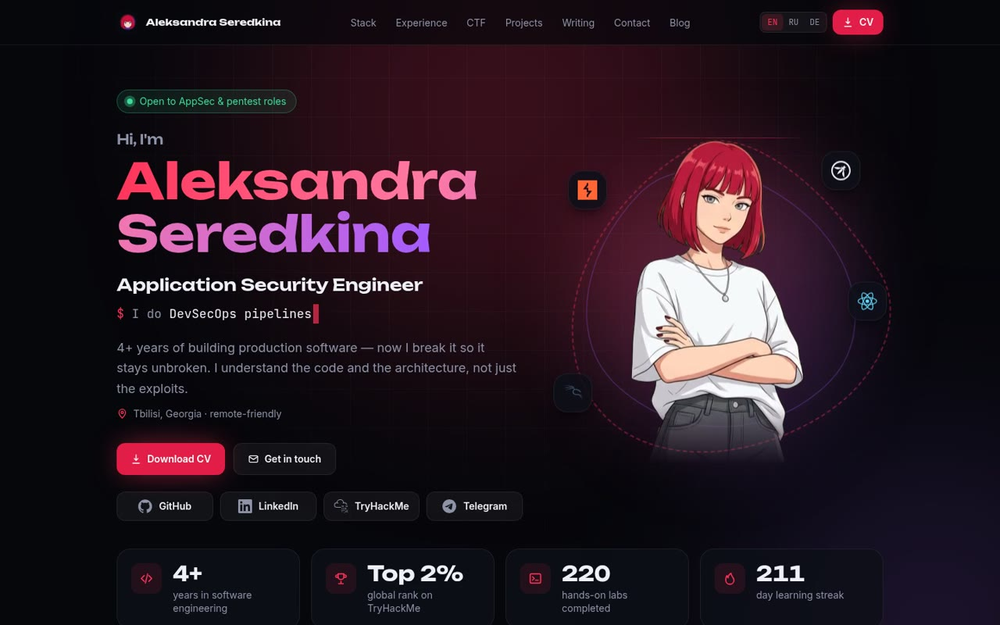
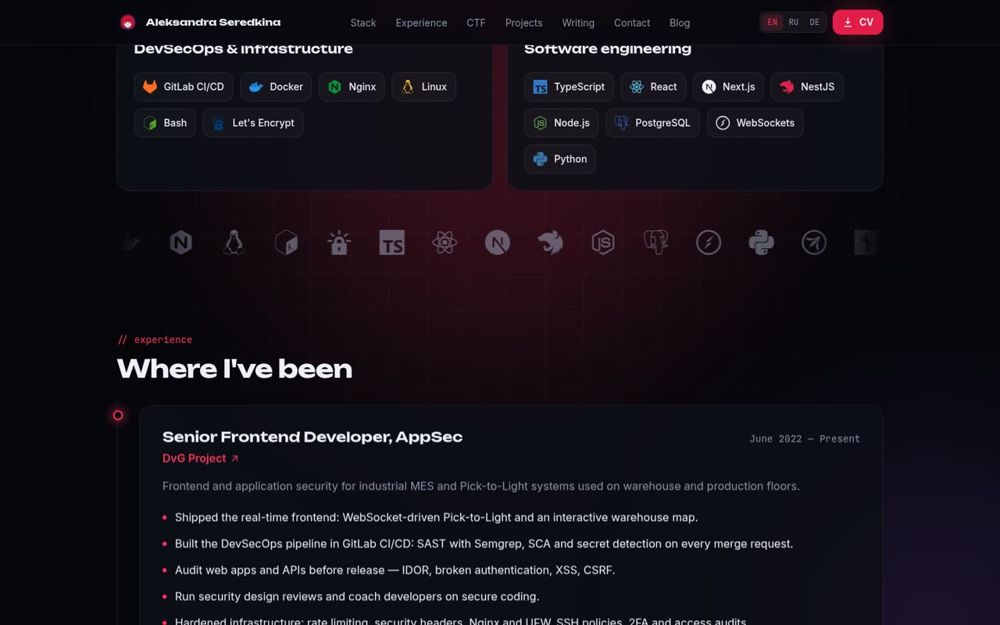
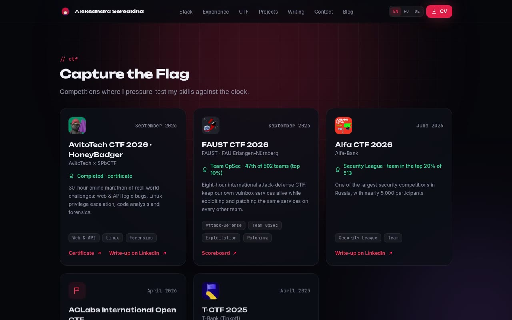
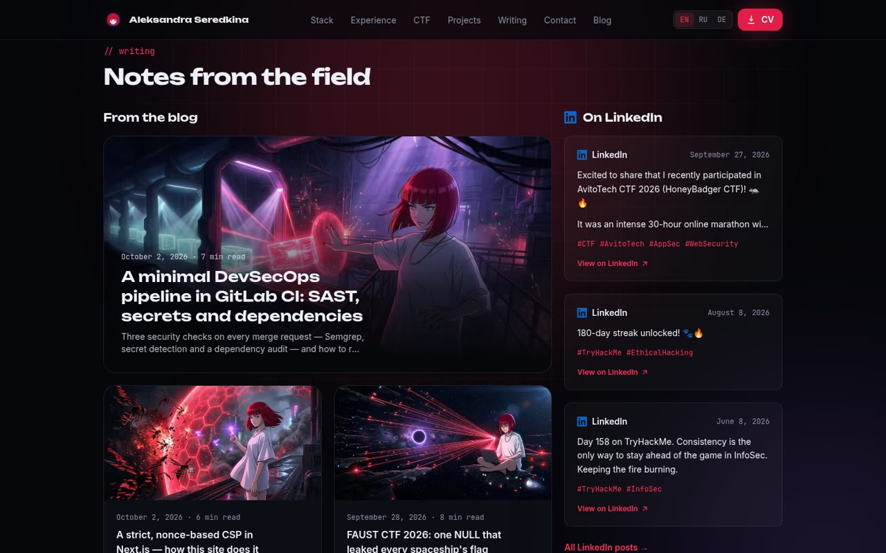
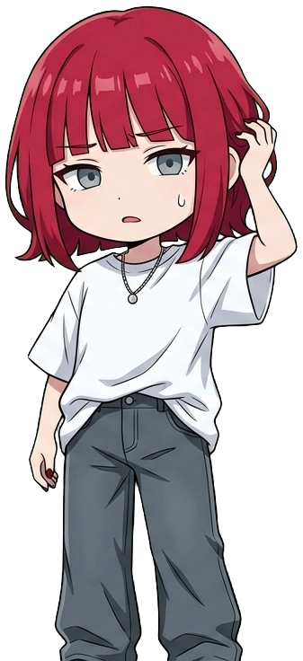

<p align="center">
  
</p>

<h1 align="center">seredkina.dev</h1>

<p align="center">
  Personal site — <strong>Aleksandra Seredkina</strong>, Application Security Engineer.<br>
  <a href="https://seredkina.dev">seredkina.dev</a>
  · EN / <a href="https://seredkina.dev/ru">RU</a> / <a href="https://seredkina.dev/de">DE</a>
  · <a href="assets/video/site-scroll.mp4">walkthrough</a>
</p>

<p align="center">
  
  
  
  
  
  
  
  
  
  
  
  
  
</p>

## Screenshots

[](assets/video/site-scroll.mp4)

| Stack & experience | CTF | Writing |
| :---: | :---: | :---: |
| [](assets/video/site-scroll.mp4) | [](assets/video/site-scroll.mp4) | [](assets/video/site-scroll.mp4) |

Full scroll: [`assets/video/site-scroll.mp4`](assets/video/site-scroll.mp4) (54s, 1440×900).

## What's here

- One-page portfolio: stack, experience, CTFs, projects, writing, contact
- Blog in MDX — `en` / `ru` / `de` per post, optional cover, drafts
- Locale in the URL only — no cookies, no `Accept-Language` redirects
- Copy in `messages/`, facts in `src/config/` — components stay dumb

## Stack

Next.js 16 App Router + RSC · React 19 · TypeScript (strict) · Tailwind 4 · Motion · next-intl · MDX + Shiki · Zod · Biome · Vitest · Playwright + axe.

Also: `remark-gfm`, `rehype-pretty-code`, `simple-icons` (SVG sprite, no icon CDN).

## Security

No cookies. No analytics. No third-party scripts. Fonts self-hosted via `next/font`.

**CSP** — new nonce every request (`src/proxy.ts` + `src/lib/csp.ts`). Production scripts: nonce + `strict-dynamic`, no `unsafe-inline` / `unsafe-eval`. E2E asserts every `<script>` carries that response's nonce.

```
default-src 'self'
script-src 'self' 'nonce-…' 'strict-dynamic'
style-src 'self' 'nonce-…'
style-src-attr 'unsafe-inline'   # Shiki inline styles only
object-src 'none'; base-uri 'self'; frame-ancestors 'none'
upgrade-insecure-requests        # HTTPS only
```

**Headers** (`next.config.ts`): HSTS 2y + preload · `X-Frame-Options: DENY` · `nosniff` · COOP/CORP `same-origin` · locked `Permissions-Policy` · no `X-Powered-By`.

**Other**

- Optional Basic auth (`SITE_PASSWORD`) — constant-time password check
- `SITE_NOINDEX=1` for private previews
- Escaped JSON-LD (no `</script>` breakout)
- [`/.well-known/security.txt`](https://seredkina.dev/.well-known/security.txt)

## Layout

```
src/
├── app/[locale]/     # pages + OG image
├── components/       # sections · motion · ui · icons
├── config/           # site, profile, character
├── content/posts/    # <slug>/{en,ru,de}.mdx
├── i18n/ · lib/ · proxy.ts
messages/             # en · ru · de
public/ · assets/ · tests/
```

## Commands

```bash
pnpm dev        # localhost:3000
pnpm check      # lint + types + unit + build
pnpm test:e2e   # Playwright + axe (prod build on :3100)
```

| Env | |
| --- | --- |
| `NEXT_PUBLIC_SITE_URL` | Canonical origin (default `https://seredkina.dev`) |
| `SITE_PASSWORD` | Basic auth for the whole site |
| `SITE_NOINDEX` | `1` → noindex + robots disallow |
| `PW_CHANNEL` | `chrome` → local Chrome for e2e |

## Artwork

Site character — poses in `public/character/`.

| hero | wave | laptop | reading | lost |
| :---: | :---: | :---: | :---: | :---: |
|  |  |  |  |  |
